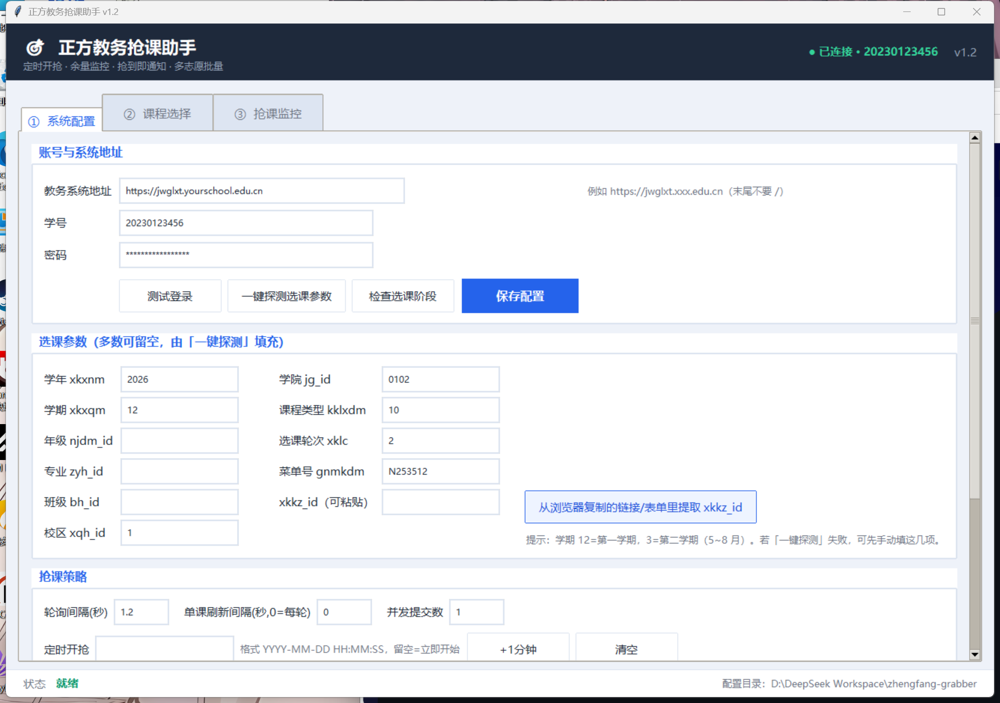
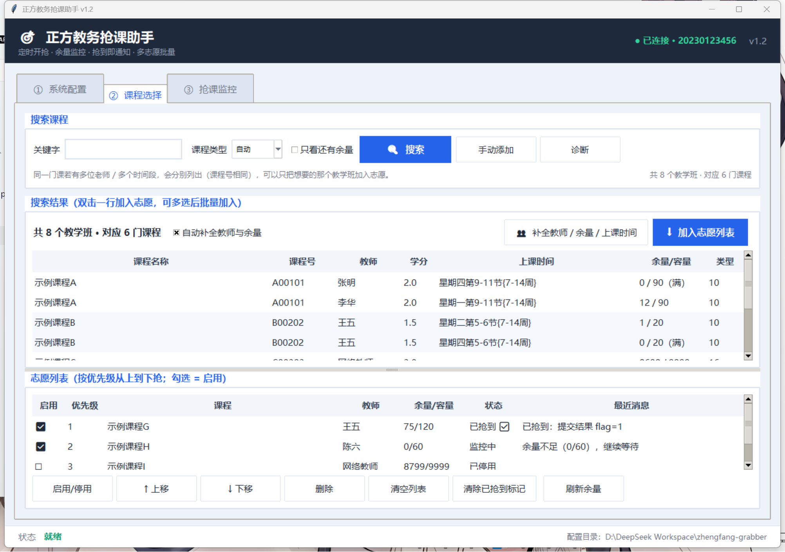
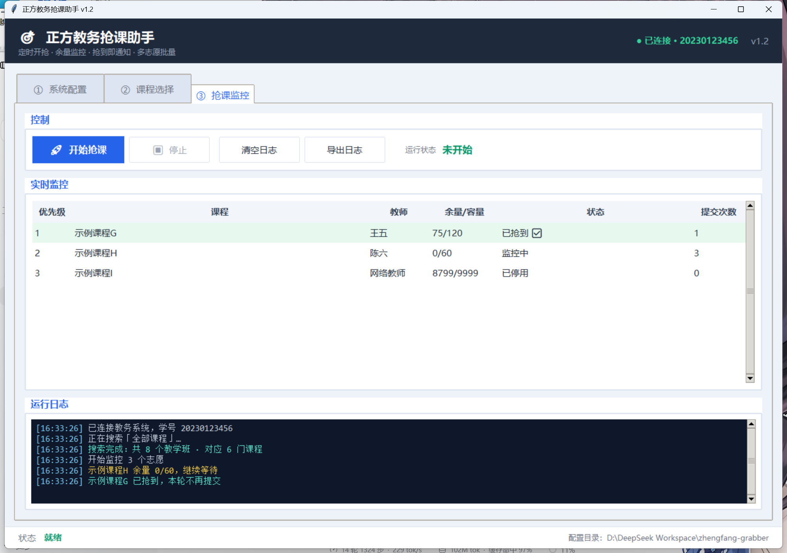

# 正方教务抢课助手

针对**新正方教务系统（jwglxt，2019 及以后版本）**的桌面抢课工具。
Python + Tkinter 编写，可打包成单文件 exe，双击即用。

> ⚠️ **免责声明**：本项目仅供个人学习与选课便利使用。请遵守所在学校的教务系统使用规定，
> 不要设置过高的轮询频率（建议 ≥ 1 秒），避免对服务器造成压力。因使用本工具产生的
> 一切后果由使用者自行承担。

---

## 功能

| 功能 | 说明 |
|---|---|
| 自动登录 | 复刻官方 `login.js` 的 RSA/ECB/PKCS1 密码加密 + CSRF Token 提交（纯 Python 实现） |
| 课程搜索 | 调用教务搜索接口，按关键字列出可选教学班及实时余量 |
| 教师 / 时间 / 余量补全 | 搜索结果本身**不含**教师与容量，程序会自动（或点按钮）逐个查教学班，把**教师、余量、上课时间**补进结果表 |
| 教学班级展开 | 同一门课有多位老师 / 多个时间段时**分行列出**，可只把想要的那个老师加入志愿 |
| 只看还有余量 | 一个复选框即可隐藏已满教学班（状态栏说明隐藏了几个），与教务网站看到的数量对齐；**默认不勾选**，满员教学班也照常列出 |
| 志愿列表 | 多课程 / 多教学班，可勾选启用、上下调整优先级 |
| 余量监控 | 按设定间隔轮询，检测到有人退课（余量 > 0）立即提交 |
| 定时开抢 | 指定 `YYYY-MM-DD HH:MM:SS`，临近时用 5ms 精度对齐抢占先机 |
| 并发提交 | 命中余量时可多线程同时提交同一教学班，提高成功率 |
| 断线重连 | 会话过期自动重新登录，网络错误自动退避重试 |
| 防重复退课 | 已抢到的课程会被记入持久标记，重启后不会再次提交（避免误退课） |
| 结果通知 | 桌面弹窗 / 邮件（SMTP）/ Webhook（Server酱·PushPlus·企业微信·钉钉） |
| 运行日志 | 带颜色分级，支持导出，便于排查 |
| 零原生依赖 | RSA 加密用纯 Python 实现，无 `.pyd`、无 VC 运行库要求 |

> ⚠️ **重要安全提醒**：新正方在「计划内选课」中对**已选上的课程重复提交，有一定概率把该课程退掉**。
> 本程序因此在课程抢到后写入持久标记，之后即使重启程序、重新点「开始抢课」，也**不会**再提交这些课程。
> 只有在「课程选择」页显式点击 **「清除已抢到标记」** 并确认后，才会重新提交。
> 请勿在抢到课后反复点开始，除非你确实想改抢别的教学班。

---

## 界面预览

三个标签页：**① 系统配置**（卡片式表单，内容超出窗口时右侧可滚动）、
**② 课程选择**（结果表与志愿表上下分栏，中间分隔条可拖动，默认 55% 给搜索结果）、
**③ 抢课监控**（实时监控表 + 深色运行日志）。

界面按 1320×900 设计（最小 1120×760），字号、行高、按钮和列宽都经过放大，
高分屏或窗口较小时也能看清；同一门课的多个教学班在结果表里**上下相邻并同底色成组**，
一眼就能分辨「示例课程A · 张明（0/90 已满）」和「示例课程A · 李华（12/90）」。







---

## 快速开始

### 方式一：直接跑源码

```bash
pip install -r requirements.txt
python run.py
```
首次运行会自动生成 `config.json`（字段说明见下文，也可以先复制仓库里的
`config.example.json` 作为模板）。**它保存你的教务地址、学号与密码，属于私有
文件**

> 依赖只有一个 `requests`。RSA 加密由项目内的 `pkcs1.py` 用**纯 Python** 实现，
> 不需要 `pycryptodome`、不需要 VC 运行库、不需要任何原生扩展 —— 打包成 exe 后
> 在别人的电脑上不会因为缺 `.pyd` 或系统安全策略而启动失败。

### 方式二：打包成 exe

```bash
pip install pyinstaller
python build.py
# 产物 1：dist/正方抢课助手.exe                 单文件版（运行时解压到 %TEMP%）
# 产物 2：dist/正方抢课助手-文件夹版/正方抢课助手.exe  文件夹版（不解压，最稳）
```

把 exe 放到一个空目录里运行，首次启动会自动生成 `config.json`。

> 单文件版方便转发，但**每次启动都要把运行时解压到系统临时目录**，
> 少数安全软件（实测火绒）会拦这一步并报
> `Could not create the temporary directory`
> 解决方法：把 exe 加入信任区。


> `build.py` 会固定 `PYTHONHASHSEED=0` 并在失败时自动重试 3 次。PyInstaller 的
> 分析阶段对模块遍历顺序敏感，放任哈希随机时同一个命令会**时好时坏**
> （实测报过 `TypeError`、`SystemError: Unmatched paren in format`、
> `0xC0000005` 访问冲突三种不同错误），固定种子后即可稳定成功。
>
> 若打包在受限的沙箱/应用控制策略环境下失败（报 `PermissionError: [WinError 5]
> 拒绝访问`，堆栈落在 PyInstaller 的隔离子进程 `create_pipe`），那是沙箱禁止创建
> 命名管道所致，与本项目无关 —— 在普通 Windows 上 `pip install pyinstaller` 后
> 重新执行即可。

### 运行测试

```bash
python tests/run_all.py
```

不联网、不接触真实教务系统：本地起一个模拟正方服务器跑通全链路，真正构造
GUI 验证控件与配置读写，并覆盖引擎的定时开抢与 start/stop 生命周期。

七个测试文件共 130+ 项断言，正常情况下应全部 PASS：

```
tests/mock_server_test.py     登录 → 搜索 → 取教学班 → 提交 全链路（含纯 Python RSA 往返）
tests/search_fallback_test.py 复刻「必须先点查询才出课程」的学校，验证搜索兜底与诊断记录
tests/paging_test.py          复刻「只能搜到少量课程」「提交恒回 flag=0」「提交被权限网关回『无操作权限！』」，守住搜索翻页窗口
                              与提交请求体必须恰好是浏览器那 19 个字段、且必须带 gnmkdm 查询串
tests/xkkz_parse_test.py      xkkz_id 的各种页面形态、取值优先级、剪贴板文本提取
tests/gui_smoke_test.py       真实 Tkinter 界面、配置往返、志愿列表、事件队列、诊断反馈、
                              教学班分行与「只看还有余量」过滤
tests/engine_test.py          定时开抢、start/stop 生命周期、已抢到不重复提交
tests/live_check.py           可选：对着真实教务系统只读体检（需自行配置 config.json）
```

另有 `tests/live_check.py`：**连真实教务系统**的体检脚本（登录 → 搜索 → 取教学班
与余量，不会提交选课），用来在自己的学校环境里验证协议是否一致：

```bash
python tests/live_check.py
```

> `mock_server_test.py` 里有一项与 `pycryptodome` 的交叉验证：如果本机装了
> `pycryptodome` 但被安全策略拦截（会打印 `[SKIP]`），不影响其余断言 ——
> 核心逻辑本来就不依赖它。

> **已在真实教务系统上验证**（2026 年实测某高校新版
> `jwglxt`，出于隐私学校名与域名已隐去）：登录、搜索课程（自动翻页）、取教学班与余量全部跑通 —— 教学班显示
> **教师、上课时间与余量**（如「余量 12/90」「0/90（满）」）。真实环境体检脚本：
> `python tests/live_check.py`（只查不提交，不会动课表）。
>
> 但不同学校的接口细节仍有差异，**请先用「测试登录」「搜索」「刷新余量」确认
> 你的学校与本程序一致，再正式使用**。其它学校若仍搜不到课程，多半是上面
> 「6. 服务端会因为页面渲染字段直接报错」之外的新差异，把 `测试登录` /
> `诊断` 输出的日志反馈即可。

---

## 使用步骤

1. **系统配置** 页填写：
   - `教务系统地址`：如 `https://jwglxt.yourschool.edu.cn`（**末尾不要带斜杠**）
   - `学号`、`密码`
2. 点 **「测试登录」** 确认账号可用。
3. 点 **「一键探测选课参数」**，自动填充 `njdm_id` / `zyh_id` / `bh_id` / `xkkz_id` 等。
4. **课程选择** 页输入课程关键字 → **搜索** → 选中结果 → **加入志愿列表**。
   （也可以「手动添加」，已知课程号时最快）
   - 搜索结果默认会**自动补全**教师 / 余量 / 上课时间（每门课一次请求，50 门课约 10 秒）。
     补全后同一门课若有多位老师会**分行列出**，可以只挑想要的那位老师加入志愿。
   - 默认**不过滤**，满员的教学班也会列出来（这样同一门课的每位老师都看得到）。
     需要只看还能抢的课时，勾选 **「只看还有余量」**：已满教学班会被隐藏，
     状态栏会注明「已隐藏 N 个已满教学班」。这就是「网站显示 50 门、软件列出 57 条」
     的由来 —— 见下方 FAQ。
   - 若你的学校**打开选课页时课程列表是空的、必须点一下「查询」才出课程**，
     本程序已经处理：搜索请求会自动带上 `xkkz_id`，并在关键字没有匹配结果时
     自动改用「空关键字查询」把课程全部列出来，状态栏会注明
     「关键字无匹配，已列出全部课程」。
   - 仍然搜不到时，点搜索框旁边的 **「诊断」** 按钮：它会把登录、页面解析、
     解析到的 `xkkz_id`、搜索响应字段名和每一次尝试写进日志，便于定位原因。
5. 调整志愿优先级，勾选要抢的课。
6. **抢课监控** 页点 **「🚀 开始抢课」**。命中余量会自动提交，抢到后弹窗/邮件通知。
7. 抢到后引擎会**自动停止**，该课程在列表里标记为「已抢到 ✅」。此时即使重启程序，
   也不会再提交它 —— 这是为了避免「重复提交导致已选课程被退掉」。
   若确实要重抢，在「课程选择」页点 **「清除已抢到标记」** 并确认。

---

## 配置文件说明（config.json）

| 字段 | 含义 | 备注 |
|---|---|---|
| `base_url` | 教务系统根地址 | 必填，无末尾斜杠 |
| `username` / `password` | 学号 / 密码 | 必填 |
| `xkxnm` / `xkxqm` | 选课学年 / 学期 | 学期 `12`=第一学期，`3`=第二学期（5~8 月） |
| `njdm_id` | 年级代码 | 如 `2023`，留空则从学号前四位推断 |
| `zyh_id` | 专业代号 | 可自动探测 |
| `bh_id` | 班级号 | 如 `23195101`，可从学号截取 |
| `xkkz_id_<kklxdm>` | 选课轮次标识 | 每种课程类型一个；自动探测后写入，也可手工填 `xkkz_id_10` |
| `xkkz_id_auto` | 选课轮次标识（通用） | 界面提取功能写入，各课程类型共用时的兜底值 |
| `poll_interval` | 全局轮询间隔（秒） | 默认 `1.5`，**不建议低于 1.2** |
| `monitor_interval` | 单课刷新间隔（秒） | `0` = 每轮都刷 |
| `concurrent_submit` | 并发提交线程数 | 默认 `1`，调高会增加服务器压力 |
| `start_time` | 定时开抢时间 | `YYYY-MM-DD HH:MM:SS`，留空立即开始 |
| `submit_even_if_full` | 余量为 0 也提交 | 部分学校支持排队/候补时才开 |
| `bad_keys` | 自动学到的「有害请求字段」 | 程序自己维护（默认已含 `localeKey`/`cdTsxx`/`pageNumber`），清空后会重新探测 |
| `notify_*` | 通知渠道开关与参数 | 见下 |

---

## 项目结构

```
zhengfang-grabber/
├── run.py             启动入口（依赖检查 → 拉起 GUI）
├── gui.py             Tkinter 图形界面（三个标签页）
├── engine.py          抢课引擎：监控循环、提交、重连、通知触发
├── jwglxt.py          教务系统客户端：登录、搜索、取教学班、提交
├── pkcs1.py           纯 Python RSA / PKCS#1 v1.5 加密与 DER 编解码
├── notifier.py        通知模块：桌面 / 邮件 / Webhook
├── config.py          配置读写（config.json）
├── build.py           PyInstaller 打包脚本
├── 启动.bat           Windows 一键启动
├── requirements.txt   依赖清单（只有 requests）
├── tests/
│   ├── run_all.py               一键跑全部测试
│   ├── mock_server_test.py      模拟正方服务器 + 全链路端到端测试
│   ├── search_fallback_test.py  搜索兜底：复刻「必须先点查询」的学校
│   ├── paging_test.py           搜索翻页窗口 + 提交体参数（复刻「搜不全 / 抢不上」）
│   ├── xkkz_parse_test.py       轮次标识 xkkz_id 的页面形态解析、取值优先级、剪贴板提取
│   ├── gui_smoke_test.py        GUI 控件、配置读写与诊断反馈测试
│   ├── engine_test.py           定时开抢与引擎生命周期测试
│   └── live_check.py            真实教务系统体检（登录 → 搜索 → 余量，只查不提交）
├── config.json        运行后自动生成
└── wishlist.json      志愿列表，运行后自动生成
```
## 注意事项
这只是一个工具，不保证百分百抢到课，软件在我自己尝试中并未出现bug，恳请您在遇到bug时提交issues或者通过peo67i@163.com联系我，谢谢

## 如果帮到了您请给我点个star，这对我很有帮助，谢谢！！！
